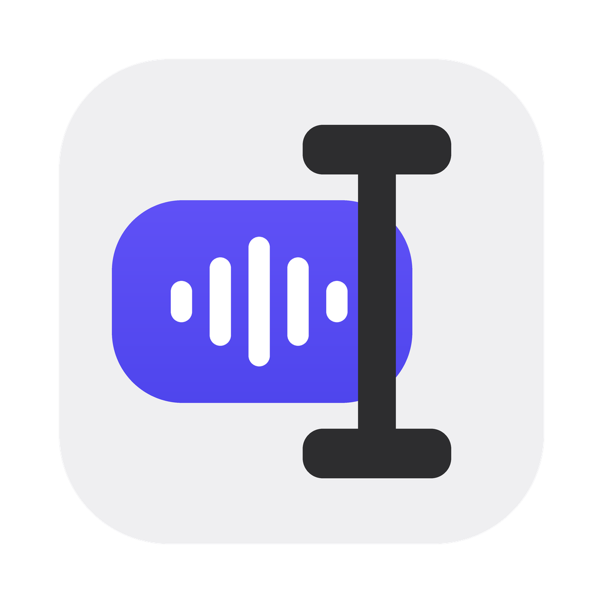
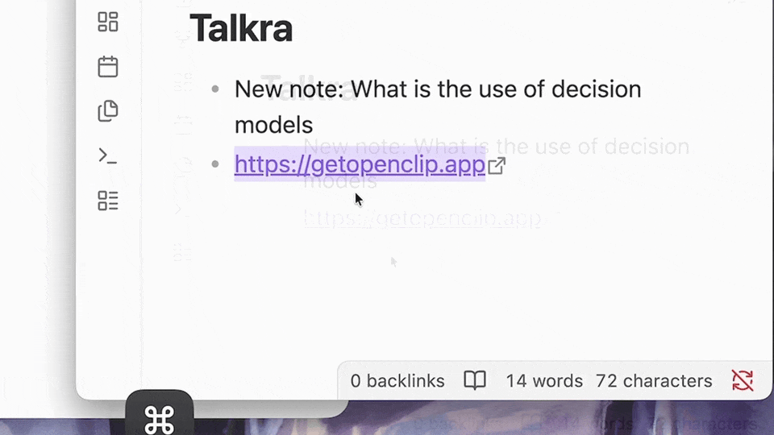

<div align="center">
  
  <h1>Talkra</h1>
  <p>Hold a key, talk to your Mac. A push-to-talk voice agent for macOS.</p>

  <p>
    
    <a href="LICENSE"></a>
    
  </p>
</div>

<br />

> **Beta, not a production build.** Talkra is experimental and built on [OpenClip](https://github.com/ganeshmshetty/openclip). It may misroute commands or change between versions, so don't rely on it for anything important. It isn't actively maintained, so issues and PRs may go unanswered. Feel free to fork it.

<div align="center"></div>

Select something in any app, hold **⌥ Space**, say what you want, and let go.

| Select… | Say… | What happens |
| :--- | :--- | :--- |
| a link | "open this link" | opens it in your browser |
| a link | "create a QR code" | shows a QR code for it |
| some text | "clean the em dash" | runs your installed *Clean Em Dash* action |
| some text | "add this to notes" | saves it to Notes |
| some text | "make this shorter" | rewrites the selection in place |
| nothing | "why is the sky blue" | answers in a small card |

## How it decides what to do

1. **Installed actions first.** If what you said clearly names an action you have installed, it runs straight away with no AI call.
2. **Otherwise an AI model routes it.** It picks an installed action, rewrites the selection, answers in a card, writes a small script (JavaScript, shell or AppleScript) with one self-repair retry, or asks you with tappable choices when it's ambiguous.
3. **Speech is transcribed on your Mac** with Apple's on-device speech recognition.

Optionally, a fast typed **decision model** (TypeSafe Jev, Cloudflare Clef, or a local decision server) can do step 2 instead. If it fails or isn't sure, your normal AI provider takes over.

## Install

Download the latest `.dmg` from [Releases](../../releases) and drag Talkra to Applications.

Or build it yourself (macOS 14+, Xcode 16+, [XcodeGen](https://github.com/yonaskolb/XcodeGen)):

```bash
brew install xcodegen
./scripts/dev_run.sh   # builds, signs locally and launches "Talkra Dev"
```

On first launch Talkra asks for:

- **Accessibility**, to read the text you've selected
- **Microphone** and **Speech Recognition**, while you hold the shortcut

## AI providers

Pick one in **Preferences → AI**. Cloud is the default.

- **Cloud**: OpenAI, Anthropic, Google Gemini, DeepSeek, Groq, OpenRouter, Cloudflare Workers AI, or any OpenAI-compatible endpoint (bring your own key)
- **CLI**: your installed Claude / Codex style CLI
- **Local**: LM Studio, Ollama or any local OpenAI-compatible server
- **Apple Intelligence**: on-device, for rewrites and answers. Its small model is not allowed to write scripts, and it can misroute commands.

API keys are stored in `~/.openclip/secrets.json` (mode 0600), never in preferences.

## Actions

Actions are the same extension packages OpenClip uses (JavaScript, shell, AppleScript, URL) in `~/.openclip/extensions`. Install or write your own and Talkra can run them by voice. The extension format is documented in the [OpenClip extensions repo](https://github.com/ganeshmshetty/openclip-extensions).

## Credits and license

Talkra is a fork of [OpenClip](https://github.com/ganeshmshetty/openclip) by Ganesh M and contributors, and keeps its **AGPL-3.0** license. See [LICENSE](LICENSE) and [NOTICE.md](NOTICE.md). The selection-reading code comes from the OpenSelection package. PopClip is a trademark of Pilotmoon Software; this project is not affiliated with it.

Contributor and architecture notes (inherited from OpenClip) are in [AGENTS.md](AGENTS.md) and [CONTRIBUTING.md](CONTRIBUTING.md).
